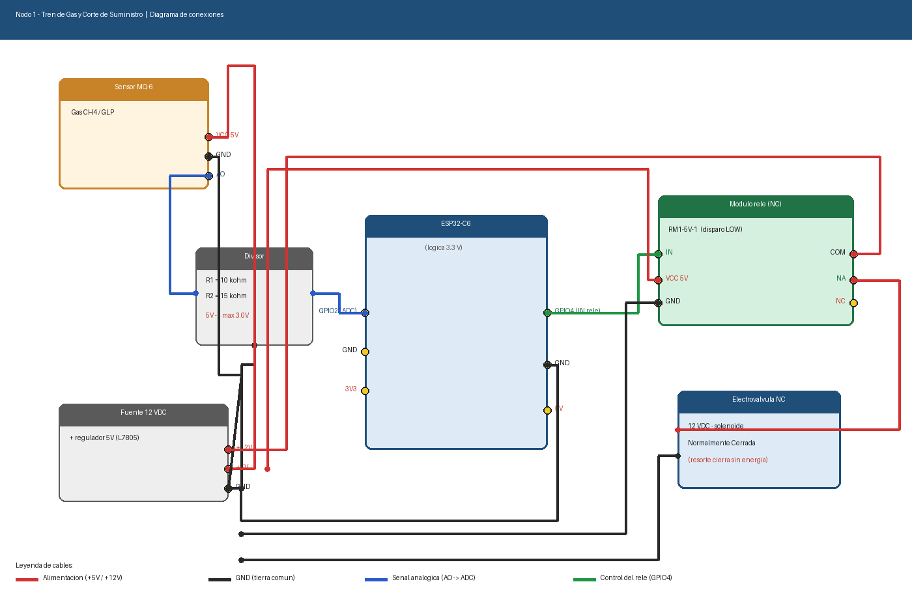
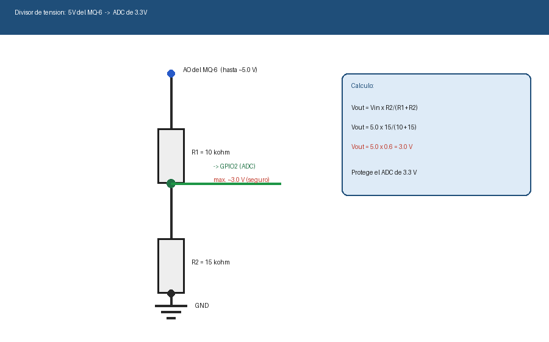

# Nodo 1 — Tren de Gas y Corte de Suministro (ESP32-C6)

Firmware del primer nodo de campo del sistema de **seguridad diferenciada para recintos
de combustión** (gas natural CH₄ / GLP). Este nodo vigila la **fuga de combustible sin quemar**
y, ante peligro, **corta el suministro de gas** cerrando una electroválvula normalmente cerrada (NC).

> Regla de seguridad clave: este nodo **nunca** enciende extractores. Ante una fuga de gas
> combustible, encender un motor eléctrico no certificado podría provocar una chispa en una
> atmósfera potencialmente explosiva. La acción correcta es **cortar el gas** y **avisar** (la
> baliza la activa el Nodo 3).

---

## Función

- Mide gas combustible (CH₄/GLP) con un sensor **MQ-6** (analógico, por ADC).
- Publica telemetría por **CoAP Observe** en `/env/air` con payload **CBOR < 52 bytes**.
- Expone el recurso de actuación `/act/cutoff` (**PUT CON idempotente**).
- Controla el relé que energiza la **electroválvula NC**:
  - relé energizado (GPIO en **LOW**) → válvula **abierta** → paso de gas (piloto verde);
  - relé apagado (GPIO en **HIGH**) → válvula **cerrada** → corte (piloto rojo).

### Principio fail-safe (normalmente cerrada)
La válvula NC cierra por **resorte mecánico** cuando pierde energía. Por eso, ante fuga,
falla de sonda o corte eléctrico, el firmware **desenergiza el relé** y el gas se corta en < 1 s.
El arranque también es seguro: el nodo inicia con la **válvula cerrada** hasta que la red está lista.

---

## Mapa de pines

| Señal | Pin ESP32-C6 | Notas |
|-------|-------------|-------|
| MQ-6 `AO` (gas combustible) | **GPIO2** (ADC1_CH2) | Salida 5 V pasada por divisor **10 kΩ + 15 kΩ** → ≤ 3.0 V seguros para el ADC de 3.3 V |
| Relé `IN` (electroválvula NC) | **GPIO4** | Módulo RM1-5V-1, **disparo en LOW** (Low Level Trigger) |

Alimentación: 12 VDC regulada localmente a 5 V (L7805). El MQ-6 trabaja a 5 V.

---

## Diagrama de conexiones



### Tabla de cableado (paso a paso)

Conecta cada punto respetando el color de cable recomendado:

| # | Desde | Hacia | Cable | Notas |
|---|-------|-------|-------|-------|
| 1 | Fuente **+5V** | MQ-6 **VCC** | Rojo | El MQ-6 se alimenta a 5 V (su calefactor interno) |
| 2 | Fuente **+5V** | Relé **VCC** | Rojo | El módulo relé es de 5 V |
| 3 | Fuente **GND** | GND común (MQ-6, ESP32, relé, válvula) | Negro | **Tierra común obligatoria** entre todo |
| 4 | MQ-6 **AO** | **R1 (10 kΩ)** → nodo central del divisor | Azul | Señal analógica del sensor |
| 5 | Nodo central del divisor | ESP32-C6 **GPIO2** (ADC1_CH2) | Azul | Entra la tensión ya reducida a ≤ 3.0 V |
| 6 | **R2 (15 kΩ)** | GND común | Negro | Rama inferior del divisor |
| 7 | ESP32-C6 **GPIO4** | Relé **IN** | Verde | Control del relé (disparo en LOW) |
| 8 | ESP32-C6 **GND** | GND común | Negro | Referencia de la lógica |
| 9 | Fuente **+12V** | Relé **COM** | Rojo | Alimenta la carga de la electroválvula |
| 10 | Relé **NA** | Electroválvula **(+)** | Rojo | Al cerrar el relé, energiza la válvula (la abre) |
| 11 | Electroválvula **(−)** | GND común | Negro | Retorno de la válvula |

> ⚠️ **Lo más importante:** todos los dispositivos deben compartir la **misma tierra (GND)**.
> Si la ESP32-C6 y la fuente de 12 V no comparten GND, el ADC medirá valores erráticos y el
> relé puede no conmutar.

> La ESP32-C6 trabaja a **3.3 V** y su ADC **no tolera 5 V**. Por eso la salida `AO` del MQ-6
> (que puede llegar a ~5 V) **nunca** se conecta directa al GPIO2: siempre pasa por el divisor.

### Detalle del divisor de tensión



El divisor reduce la salida de 5 V del sensor a un máximo seguro de ~3.0 V para el ADC:

```
Vout = Vin × R2 / (R1 + R2) = 5.0 × 15 / (10 + 15) = 3.0 V
```

- **R1 = 10 kΩ** en serie (entre `AO` del MQ-6 y el nodo de salida).
- **R2 = 15 kΩ** del nodo de salida a GND.
- El **nodo central** (unión de R1 y R2) es el que va a **GPIO2**.

---

## Recursos CoAP

| Recurso | Método | Payload CBOR | Descripción |
|---------|--------|--------------|-------------|
| `/env/air` | GET (+ Observe) | mapa `{t,g,v,f}` | Telemetría: tipo de nodo, índice de gas 0–100, estado de válvula, flag de falla |
| `/act/cutoff` | PUT CON | entero `1`=cerrar, `0`=abrir | Corte/reposición de gas. Idempotente. La reapertura se rechaza (4.03) si hay peligro vigente |

**Telemetría `/env/air` (CBOR, claves de 1 carácter para caber en < 52 B):**
- `t`: tipo de nodo (1 = tren de gas)
- `g`: índice de gas combustible 0–100
- `v`: estado de válvula (0 abierta, 1 cerrada)
- `f`: falla de sonda (0/1)

**Contrato de frescura (RF-06):** `/env/air` declara `Max-Age = 60 s`. Si la sonda se desconecta
o satura, el filtro de plausibilidad lo detecta y la central lo interpreta como `5.03 Service
Unavailable` a los 60 s.

---

## Lógica de seguridad del nodo

La **central (BeaglePlay)** toma la decisión global, pero el nodo también actúa por sí solo si
pierde el enlace (autonomía, RF-07):

- **Gas ≥ umbral de corte** → cierra la válvula (`/act/cutoff`).
- **Sonda en falla** → corte preventivo (estado seguro).
- La **reapertura nunca es automática**: requiere `PUT /act/cutoff` con `v=0` desde la central,
  y solo se acepta si ya no hay condición de peligro.

Umbrales de arranque (se calibran en campo), en `nodo1_tren_gas.c`:

```c
#define UMBRAL_GAS_ALERTA   45.0f   // aviso temprano
#define UMBRAL_GAS_CORTE    60.0f   // corte inmediato (cercanía al LEL)
```

---

## Compilar y flashear

Requiere **ESP-IDF ≥ 5.1** con soporte OpenThread para ESP32-C6.

```bash
cd firmware/nodo1_tren_gas
idf.py set-target esp32c6
idf.py build
idf.py -p /dev/ttyACM0 flash monitor
```

El `sdkconfig.defaults` ya fija: target `esp32c6`, OpenThread FTD, CoAP, radio 802.15.4 nativa,
IPv6 y Canal 25.

---

## Pruebas de la matriz que aplican a este nodo

- **PV-04A (Fuga CH₄):** liberar gas frío de encendedor (sin chispa) ~2 s sobre el MQ-6.
  *Criterio:* en < 2.0 s la válvula cierra (`/act/cutoff`), se activa la baliza (Nodo 3) y el
  extractor permanece **apagado**.
- **PV-05 (Fail-Safe inverso):** desconectar la señal del sensor o apagar el nodo.
  *Criterio:* error `5.03` a los 60 s o timeout a los 93 s → transición a estado seguro (corte).
- **PV-07 (Autonomía):** apagar la central e inyectar gas. *Criterio:* el Nodo 1 envía
  `PUT /act/cutoff` dentro de la malla y cierra la válvula **sin** la central.

---

## Notas de puesta en marcha

- **Sin el MQ-6 conectado**, el pin GPIO2 queda flotante y el valor `gas=` del log es solo
  **ruido eléctrico** (no es una medición real). Es normal; al conectar el sensor pasará a
  reflejar la lectura verdadera. También puede aparecer `falla=1` de forma intermitente sin
  el sensor, por la misma razón.
- El **MQ-6 requiere precalentamiento** (su calefactor interno tarda en estabilizarse). Deja
  el sensor energizado unos minutos antes de calibrar.
- La válvula aparece siempre **CERRADA** al arrancar: es el comportamiento seguro buscado.
  La apertura solo ocurre por orden explícita de la central (`PUT /act/cutoff` con `v=0`), que
  se implementará con el demonio de la BeaglePlay.

## Estado de validación

- [x] La placa arranca y ejecuta el firmware (sin panic).
- [x] Arranque seguro: válvula cerrada al inicio.
- [x] Radio Thread activa en Canal 25.
- [x] Servidor CoAP activo (`/env/air`, `/act/cutoff`).
- [x] Bucle de muestreo del sensor en ejecución.
- [ ] Validación con el MQ-6 físico conectado (pendiente de soldadura).
- [ ] Validación del relé + electroválvula.
- [ ] Calibración del umbral a ppm reales.
